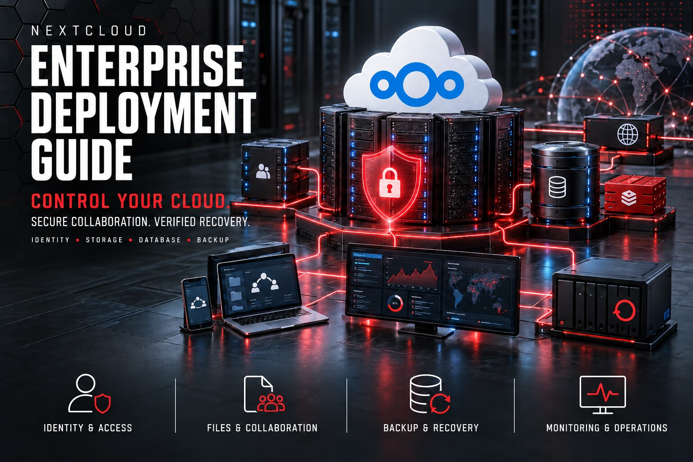

# Nextcloud Enterprise Deployment Guide

  

A production-oriented guide for designing, deploying, securing, scaling, monitoring, backing up, and recovering a self-hosted Nextcloud collaboration platform.

This independent guide is published and maintained by [SARABEL Informatika Kft.](https://sarabelinformatika.hu). It converts the upstream administration guidance into an auditable operating model for identity, storage, database, caching, reverse proxy, background jobs, applications, backup, monitoring, upgrades, and incident response.

> A successful login is not proof of a production-ready Nextcloud service. Identity, trusted proxies, storage, database consistency, Redis locking, cron, TLS, backup, recovery, monitoring, and change control must be designed as one system.

## Design goals

- Use supported components and validate requirements against the target Nextcloud release.
- Separate public ingress, application, database, cache, storage, backup, and management trust boundaries.
- Enforce named identities, MFA, least privilege, and tested break-glass access.
- Use system cron, transactional file locking, database maintenance, and observable background jobs.
- Keep primary data, database state, configuration, encryption material, and app state recoverable as one consistency set.
- Make upgrades staged, reversible, documented, and evidence-driven.
- Keep included assessment scripts read-only.

## Reference architecture

| Layer | Recommended baseline | Responsibility |
|---|---|---|
| Edge | Hardened reverse proxy and TLS | Public ingress, headers, rate controls, trusted proxy chain |
| Application | Supported Linux, web server, PHP-FPM | Nextcloud code, configuration, apps, background jobs |
| Database | PostgreSQL or MariaDB | Transactional metadata and application state |
| Cache/locking | Redis | Distributed cache, sessions where designed, transactional file locking |
| Primary storage | Redundant local, block, or supported object storage | User files and application data |
| Identity | Local MFA or managed IdP | Authentication, lifecycle, groups, recovery |
| Collaboration | Files, Talk, Groupware, Office integrations | Business workflows with explicit owners |
| Backup | Versioned local and off-site copies | Consistent recovery of data, database, config, keys, apps |
| Monitoring | Infrastructure and application monitoring | Availability, cron, queues, capacity, certificates, logs |
| Operations | Change, incident, recovery, and acceptance records | Accountability and repeatability |

## Guide map

1. [Scope, service objectives, and threat model](docs/01-scope-service-objectives-and-threat-model.md)
2. [Discovery, sizing, and dependency assessment](docs/02-discovery-sizing-and-dependencies.md)
3. [Reference architecture and trust boundaries](docs/03-reference-architecture-and-trust-boundaries.md)
4. [Host, PHP, web server, and database baseline](docs/04-host-php-web-and-database-baseline.md)
5. [Storage architecture and data directory](docs/05-storage-architecture-and-data-directory.md)
6. [Redis, caching, locking, and sessions](docs/06-redis-caching-locking-and-sessions.md)
7. [Reverse proxy, TLS, DNS, and trusted proxies](docs/07-reverse-proxy-tls-dns-and-trusted-proxies.md)
8. [Identity, MFA, LDAP, OIDC, and lifecycle](docs/08-identity-mfa-ldap-oidc-and-lifecycle.md)
9. [Applications, app governance, and collaboration](docs/09-applications-governance-and-collaboration.md)
10. [Background jobs, previews, search, and performance](docs/10-background-jobs-previews-search-and-performance.md)
11. [Security hardening, audit, and sharing controls](docs/11-security-hardening-audit-and-sharing-controls.md)
12. [Backup, consistency, retention, and recovery](docs/12-backup-consistency-retention-and-recovery.md)
13. [Monitoring, logging, alerting, and capacity](docs/13-monitoring-logging-alerting-and-capacity.md)
14. [Upgrades, maintenance, migration, and rollback](docs/14-upgrades-maintenance-migration-and-rollback.md)
15. [Business continuity and incident response](docs/15-business-continuity-and-incident-response.md)
16. [Acceptance checklist and operating model](docs/16-acceptance-checklist-and-operating-model.md)

## Quick start

1. Complete the [deployment workbook](templates/deployment-workbook.md) and dependency register.
2. Select the architecture only after documenting users, data growth, integrations, RTO, RPO, identity, and external-sharing requirements.
3. Run the read-only host preflight:

~~~bash
sudo ./scripts/nextcloud-host-preflight.sh
~~~

4. Run the read-only endpoint check:

~~~bash
./scripts/nextcloud-endpoint-check.sh cloud.example.com
~~~

5. Complete the backup coverage matrix and perform an isolated restore test.
6. Record technical validation and business approval in [acceptance-record.md](templates/acceptance-record.md).

## Included operational assets

- Read-only host, endpoint, storage, and configuration assessment scripts
- Example architecture, backup policy, and monitoring baseline
- Deployment, dependency, access, backup, change, incident, recovery, and acceptance templates
- Ports, controls, operations, limitations, and primary-source references

The scripts collect evidence only. They do not install packages, edit configuration, enable maintenance mode, update apps, restart services, modify firewall rules, create users, rotate secrets, or delete data.

## Important

Nextcloud requirements change between major releases. Validate the exact operating system, PHP, database, Redis, web-server, app, client, and integration requirements against the administration manual and release notes for the version you intend to deploy.

All hostnames, addresses, credentials, domains, users, paths, and capacity figures in this repository are examples. Replace them through a reviewed change process before production use.

## About SARABEL Informatika

[SARABEL Informatika Kft.](https://sarabelinformatika.hu) designs and operates secure business infrastructure including Nextcloud, Linux and Windows servers, Proxmox, networking, VPN, Microsoft 365, storage, monitoring, backup, and recovery.

For a Nextcloud assessment, deployment, migration, security review, backup design, or managed operation, visit [sarabelinformatika.hu](https://sarabelinformatika.hu).

## License and independence

Documentation, scripts, and original examples are released under the [MIT License](LICENSE). Nextcloud and related product names belong to their respective owners. This repository is an independent SARABEL Informatika publication and is not affiliated with or endorsed by Nextcloud GmbH.
